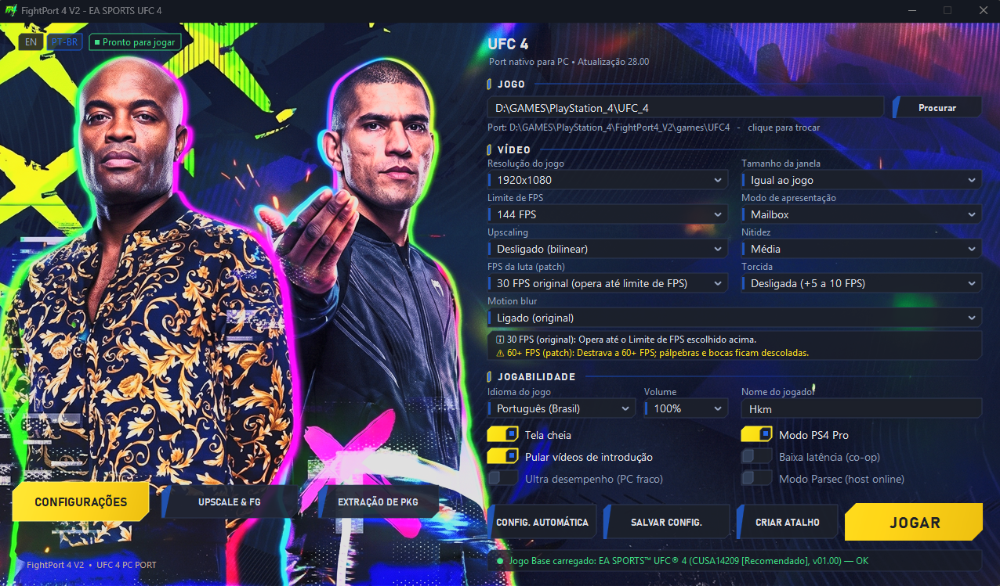
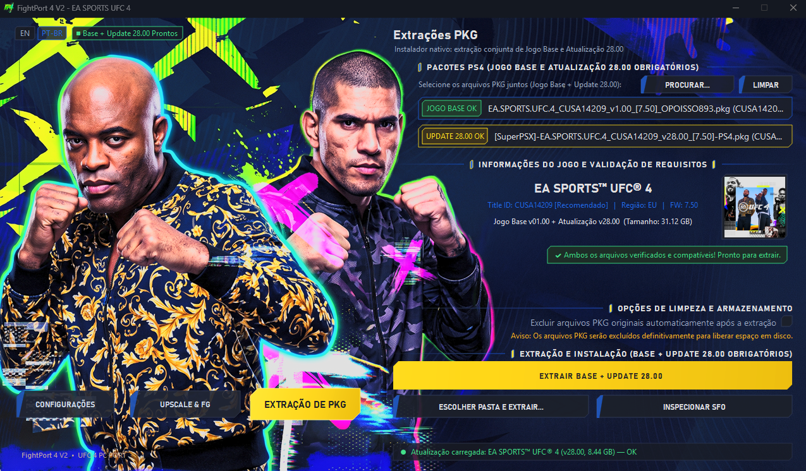
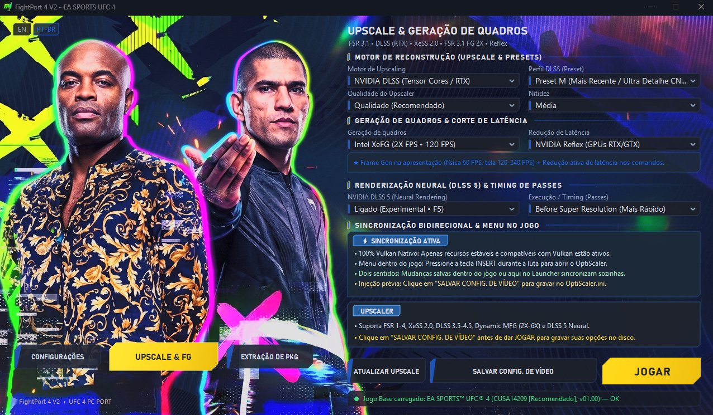
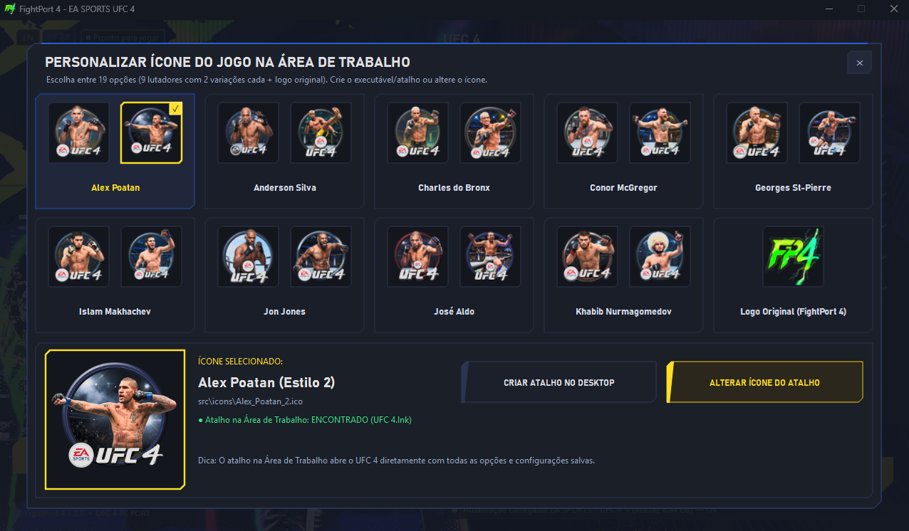
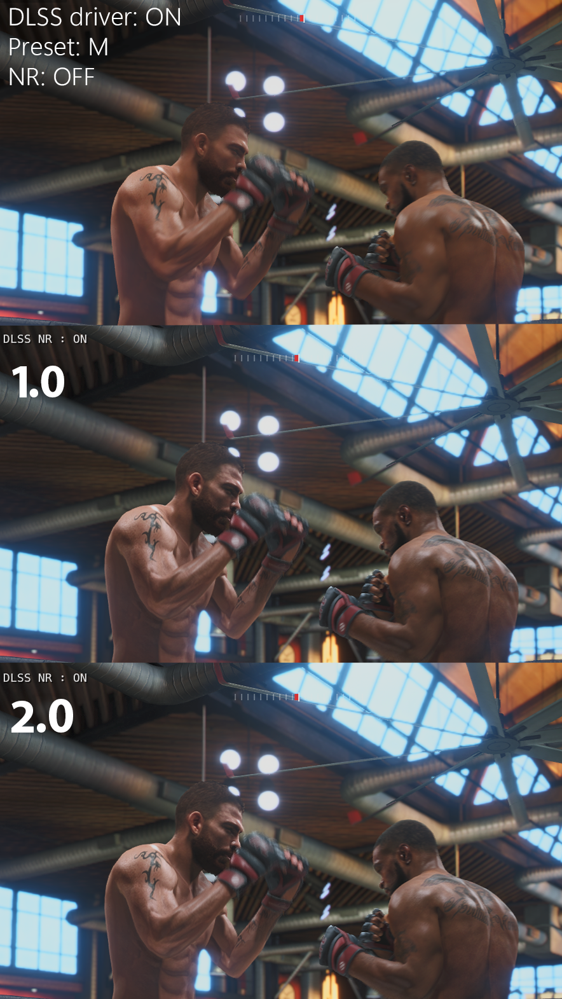
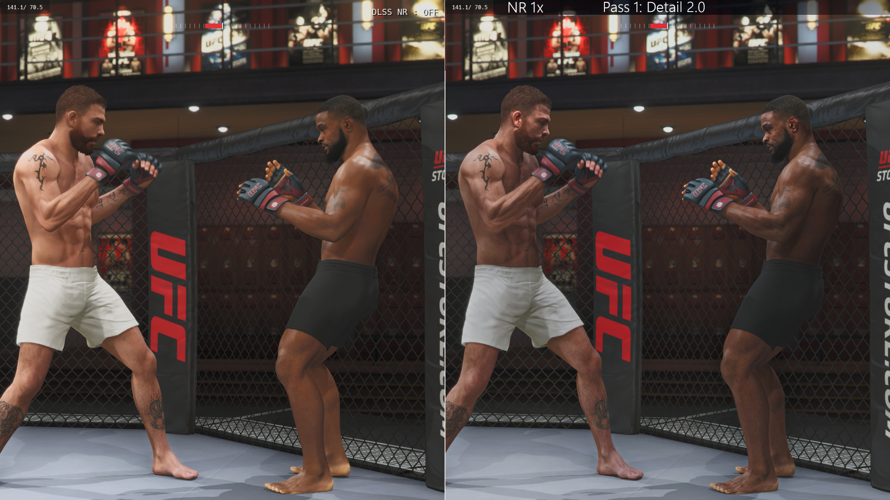
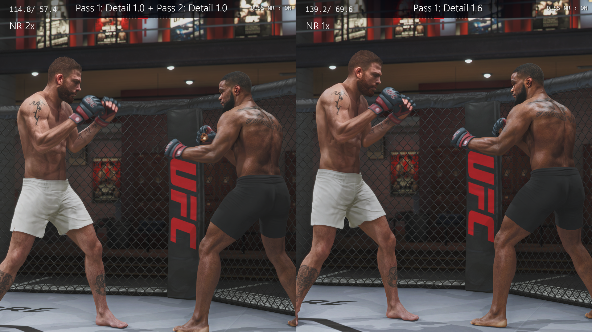
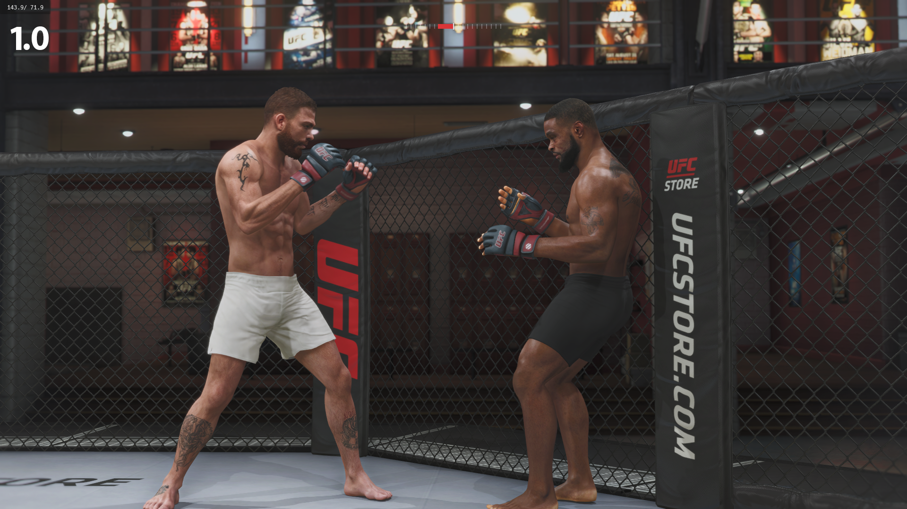
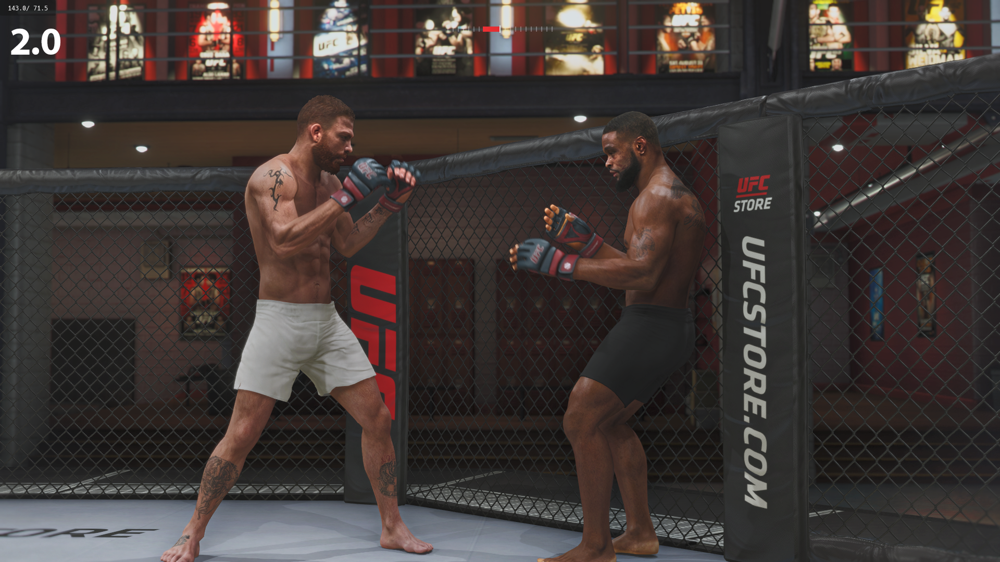

# FightPort 4 V2 (2.12.7.0) — EA SPORTS UFC 4 Native PC Port Launcher

[](https://discord.gg/sRCaE57yn)
[-gold.svg)](#)
[](https://github.com/HKM-Team)
[](licenses/LICENSE-GPL-2.0.txt)
[%20%7C%20Linux%20(Proton)-lightgrey.svg)](#)

Dedicated graphics configuration hub, performance launcher, and single-click PKG extraction system for the native PC port of **EA SPORTS UFC 4** (PlayStation 4, `CUSA14209` & `CUSA14204`, official update **28.00**).

> [!IMPORTANT]
> ### 💬 Comunidade Oficial no Discord & Suporte aos Jogos
> **Quer trocar uma ideia com a comunidade, acompanhar novidades ou precisa de suporte técnico para configurar e rodar os executáveis?**
>
> 🎮 **Servidor Oficial da HKM Team no Discord:**  
> 👉 [https://discord.gg/sRCaE57yn](https://discord.gg/sRCaE57yn)
>
> ⚠️ **AVISO OBRIGATÓRIO — ARQUIVOS DO JOGO NÃO INCLUSOS:**  
> **Ao baixar este inicializador (launcher), o jogo NÃO vem junto!**  
> Este projeto é de código aberto e **NÃO DISTRIBUI** jogos, ROMs, arquivos binários protegidos ou dados proprietários da Electronic Arts, UFC ou Sony. É **necessário possuir sua própria cópia legítima do EA SPORTS UFC 4** (Jogo Base v1.00 e Atualização Oficial 28.00 em formato `.pkg`).  
> Se você tiver dúvidas sobre como obter, extrair seus pacotes ou configurar o jogo no seu computador, nossa equipe e a comunidade estão disponíveis para te ajudar diretamente no Discord!

---

## 🥊 Português (PT-BR)

### Visão Geral
O **FightPort 4 V2 (2.12.7.0)** entrega a experiência mais avançada e moderna para jogar EA SPORTS UFC 4 no computador, executando sobre uma camada nativa de alta velocidade em **Vulkan**.

Conta com injeção direta do **OptiScaler v0.1.34-with-dlss-fg** (desenvolvido por **nitec** e comunidade), disponibilizando múltiplos motores de reconstrução de imagem (AMD FSR, Intel XeSS e NVIDIA DLSS), geração de quadros (Frame Generation para até 240+ FPS), renderização neural em passada única por IA (DLSS 5), controle de latência ultra-baixa, áudio estéreo com volume amplificado e extrator nativo de PKG em botão único.

---

### 🖥️ Interface e Telas de Configurações

O inicializador conta com três abas dedicadas para você configurar toda a sua experiência antes de entrar no octógono:

#### 1. Configurações Gerais de Vídeo e Jogabilidade
Ajuste resolução de renderização, modo de tela cheia, limite de taxa de quadros, modo PS4 Pro (Neo), opções de controle e volume do áudio com conversão estéreo 2.0 limpa.



#### 2. Extração Nativa de Pacotes (Aba `EXTRAÇÃO DE PKG`)
Instalação facilitada em botão único: selecione simultaneamente o Jogo Base (`v1.00`) e a Atualização Oficial (`v28.00`). O FightPort 4 confere a integridade do cabeçalho `PARAM.SFO` e descompacta tudo automaticamente diretamente na pasta do jogo.



#### 3. Motores de Reconstrução & Frame Generation (Aba `UPSCALE & FG`)
Personalize os melhores filtros gráficos do mercado (FSR 1.0 a 4.1.1, XeSS 1.3 a 2.0, DLSS Segunda Geração / Preset M, 3.5 e 4.5), ative a Geração de Quadros para até 240 FPS e controle a renderização neural com sincronização em tempo real (tecla `Insert` durante a luta).



---

### 🎨 Galeria com 19 Ícones Exclusivos & Criador de Atalhos

Personalize o executável oficial do jogo na sua Área de Trabalho com a foto do seu lutador favorito:
- 9 grandes lendas do MMA com 2 variações fotográficas cada (Alex Poatan, Charles do Bronx, Anderson Silva, Jon Jones, Khabib Nurmagomedov, Conor McGregor, José Aldo, Georges St-Pierre e Islam Makhachev).
- Ícone clássico oficial FightPort 4 (Logo Original).
- Criação e atualização instantânea no Windows Explorer (`SHChangeNotify`) sem reiniciar o sistema.



---

### 🧠 Reconstrução Gráfica e NVIDIA DLSS 5 (Neural Rendering)

A versão V2 traz a tecnologia mais avançada de reconstrução sub-pixel via inteligência artificial para o octógono, aumentando a estabilidade temporal em grades, cordas e detalhes anatômicos dos atletas.

> [!NOTE]
> **Esclarecimento Técnico — Passada Única & Detalhes de Textura:**  
> Nenhuma das imagens foi gerada com "duas passadas" de DLSS 5 e nem com duplicação de Frame Generation.  
> O algoritmo DLSS 5 é executado em **passada única (1.0x)**. O que os comparativos demonstram é a escala de nitidez e preservação de **detalhes de textura**:
> - **DLSS 5 com Textura 1.0x:** Reconstrução neural equilibrada com fidelidade nativa 1.0x, garantindo combate limpo e sem artefatos em movimentos rápidos.
> - **DLSS 5 com Detalhes de Textura em 2.0x:** Ampliação da densidade de microtexturas anatômicas (suor, pele, luvas, lona e malha do octógono) elevada até 2.0x sob a mesma passada neural.

> [!TIP]
> **Foco do DLSS 5 & Recomendações de Desempenho e FPS:**  
> - **Foco nos Personagens:** O DLSS 5 foi especialmente desenvolvido para aprimorar os aspectos visuais dos lutadores em si. O foco principal está na **pele, cabelo e barba**.  
> - **Cenário e Vestimentas:** O fundo e o ambiente não são alterados, enquanto detalhes de texturas em roupas e luvas recebem aplicação leve para manter o combate ágil e responsivo.  
> - **Ajuste em Tempo Real (`Insert`):** Todos esses parâmetros podem ser ajustados diretamente no menu do OptiScaler apertando a tecla `Insert` durante a luta.  
> - ⚠️ **Atenção ao Custo de Desempenho:** Lembre-se de que quanto mais você aumentar os detalhes (seja de roupas, seja do ambiente), mais pesado o jogo fica e menos FPS você terá. E quanto menos FPS você tiver, maior a chance de ocorrer efeito de arrasto (*ghosting*). Para a melhor experiência competitiva e máxima nitidez, mantenha os detalhes calibrados nos lutadores.

#### 1. Visão Geral da Tecnologia (DLSS 5 Detail)
Visão consolidada da reconstrução neural em passada única com análise comparativa de detalhes de textura:



#### 2. Comparativo de Reconstrução: DLSS Segunda Geração (Preset M) vs Detalhes Aprimorados (2X)
Demonstração comparativa entre o DLSS de Segunda Geração e os modos com detalhes refinados:




**Análise dos Painéis Comparativos:**
- **Painel Superior (`Compare_dlss_detail_2x.png`):** Confronto do DLSS Segunda Geração (Preset M) contra os detalhes ampliados em 2.0x, evidenciando o ganho de definição na malha do octógono e silhueta dos lutadores.
- **Painel Inferior (`Compare_dlss5_detail_2x.png`):** Teste comparativo entre aplicar **duas passadas (imagem da esquerda)** versus aplicar **uma única passada bem ajustada (imagem da direita)**. O que muda fundamentalmente são os valores aplicados: a passada única com valores precisamente ajustados supera duas passadas, entregando mais estabilidade temporal, menos artefatos e muito mais desempenho.

#### 3. DLSS 5 Neural Rendering (Textura Base 1.0x)
Reconstrução neural em passada única com texturas em 1.0x — máxima estabilidade temporal e resposta limpa:



#### 4. DLSS 5 Neural Rendering (Detalhes de Textura Ampliados para 2.0x)
Passada única de DLSS 5 com nitidez e microtexturas anatômicas ampliadas até 2.0x — máxima definição sub-pixel em nível de transmissão televisiva:



---

### 📦 Como Instalar e Jogar

Você pode escolher entre duas opções oficiais de distribuição:

#### Opção A: Pacote Portátil (.zip)
1. Baixe o pacote oficial na página de Releases:
   📦 **`FightPort4_V2_12.7.0.zip`**
2. Descompacte o arquivo `.zip` na pasta de sua preferência (ex: `C:\Jogos\FightPort4`).
3. Execute o **`FightPort4.exe`**.

#### Opção B: Instalador Executável (.exe)
1. Baixe o instalador oficial completo:
   💿 **`FightPort4_V2_12.7.0_Setup.exe`**
2. Siga o assistente passo a passo, escolha o local de instalação e permita a criação automática dos atalhos na Área de Trabalho e no Menu Iniciar.
3. Inicie o jogo diretamente pelo atalho criado no Desktop!

#### Extração dos Arquivos do Jogo (Primeira Execução)
1. Abra o **FightPort 4** e acesse a aba **`EXTRAÇÃO DE PKG`**.
2. Clique no botão **`PROCURAR...`** e selecione os dois arquivos juntos: o **Jogo Base v1.00** (`CUSA14209` ou `CUSA14204`) e a **Atualização Oficial 28.00**.
3. Clique em **`Extrair para o Jogo`**: o programa descompacta e mescla tudo automaticamente dentro de `games\UFC4`.
4. Defina seus gráficos na aba `UPSCALE & FG` e clique em **`JOGAR`**!

---

### 🎮 Controles & Parsec
- **Reconhecimento Plug & Play:** Suporte automático para controles de Xbox (One, Series, 360), PlayStation (DualShock 4, DualSense) e genéricos compatíveis.
- **Dois Jogadores no Mesmo PC:** Suporte a 2 controles simultâneos no mesmo computador (Player 1 e Player 2).
- **Modo Parsec:** Trava em 60 FPS com latência mínima para jogar online 1v1 contra amigos via Parsec.
- **Menu Interno Durante a Luta:** Pressione a tecla **`Insert`** a qualquer momento para abrir a sobreposição do OptiScaler em tempo real.

---

### 🛠️ Como Compilar o Código-Fonte
O FightPort 4 é escrito em C nativo com as APIs do Windows (Win32 e GDI+):
1. Abra o prompt do Visual Studio Developer (`vcvars64.bat`).
2. Navegue até a pasta `src\`:
   ```cmd
   cd src
   build.bat
   ```
3. O binário `FightPort4.exe` será gerado na raiz do projeto.

---

### 📄 Licenças e Atribuições
- **FightPort 4 UI & Core:** Licenciado sob a Tri-Licença HKM (MIT, Apache 2.0 e GPLv3).
- **OptiScaler:** Desenvolvido por **nitec** e comunidade (Licença MIT).
- **SacredFire / shadPS4 Core:** Licenciados sob a GPL v2 ou posterior.

---

## 🥊 English (EN)

### Overview
FightPort 4 V2 delivers an ultra-smooth, responsive PC experience for EA SPORTS UFC 4, running over a high-performance native **Vulkan** translation pipeline.
Featuring integrated **OptiScaler v0.1.34-with-dlss-fg** (developed by **nitec** & community), it provides next-gen image upscaling (FSR, XeSS, DLSS), Frame Generation (up to 240+ FPS), neural rendering (DLSS 5), active latency mitigation, high-clarity 2.0 stereo audio, full controller support, and integrated one-click PKG extraction.

### Key Features
- **Bidirectional In-Game & Launcher Sync:** Adjust graphics inside the launcher before playing or hit `Insert` during combat to tweak OptiScaler overlay settings in real time.
- **Next-Gen Upscaling & Frame Gen:** Support for AMD FSR (1.0 to 4.1.1), Intel XeSS (1.3 & 2.0), NVIDIA DLSS (2nd Gen Preset M, 3.5 & 4.5), single-pass DLSS 5 character-focused neural rendering (skin, hair, beard) with 1.0x to 2.0x texture detail tuning via in-game `Insert` menu, and Frame Generation up to 240+ Hz.
- **One-Click PKG Installer:** Automated extraction and patch-merging from the `EXTRAÇÃO DE PKG` tab.
- **Audio Overhaul:** Clean downmixing of 7.1 surround sound into crisp 2-channel stereo with volume amplification up to 300%.
- **Portable & Setup Options:** Distributed both as a portable `.zip` and an automated `.exe` installer.

### Portable Run Instructions
1. Download `FightPort4_V2_12.7.0.zip` or `FightPort4_V2_12.7.0_Setup.exe` from [Releases](https://github.com/HKM-Team/FightPort4/releases).
2. Extract or install into your preferred directory (e.g., `C:\Games\FightPort4`).
3. Run `FightPort4.exe`.
4. In the `EXTRAÇÃO DE PKG` tab, browse and select your base game (`v1.00`) and update (`v28.00`) PKG files.
5. Click **Extrair para o Jogo** and launch straight into combat!

### Feature & Attribution Matrix
| Module | Author / Origin | License | Status |
|---|---|---|---|
| **FightPort 4 UI & Core** | **HKM Team** (https://github.com/HKM-Team) | Tri-License (MIT/Apache 2.0/GPLv3) | Stable v2.12.7.0 |
| **PKG Extraction Engine** | **HKM Team** & OrbisPkgTool contributors | MIT / Open Source | Verified |
| **UFC 4 Native Port Engine** | SacredFire / bbport / shadPS4 core | GNU GPL-2.0-or-later | Tested v0.2.6 |
| **Upscaling & Frame Gen** | OptiScaler (nitec & community) | MIT License | Injected v0.1.34 |

### Legal Disclaimer
FightPort 4 and HKM Team are independent open-source initiatives not affiliated with, endorsed by, or connected to Electronic Arts Inc., Sony Interactive Entertainment Inc., or the Ultimate Fighting Championship (UFC). No copyrighted game files or ROMs are distributed.
